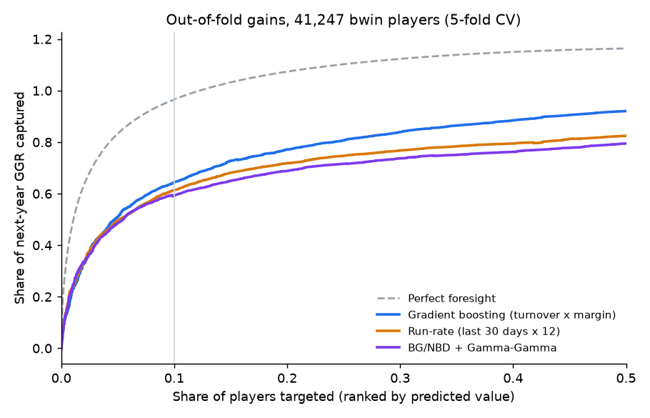

# Customer Lifetime Value and Churn Model (PySpark, Gradient Boosting)

Which new customers will be worth the most over the next year, and which are about to churn?
This project answers both from a customer's **first 90 days**, on **real daily transaction records
of 46,339 customers** of an online entertainment platform (a public research dataset, see
[Data and citation](#data-and-citation)). It compares the classic lifetime value model used in CRM
(BG/NBD + Gamma-Gamma) with a simple run-rate rule and a gradient-boosting model.

Features are built in **PySpark with Spark SQL window functions** over 2.8 million customer-day rows.



## Results (5-fold cross-validation, 41,247 customers, out-of-fold predictions)

The target is each customer's next 365 days (days 90 to 454 after their first purchase). Two
quantities are predicted. **Spend** (turnover) is the total amount customers put through the platform.
**Revenue** (GGR) is spend minus what was paid back to them.

| Model | Share of next-year revenue from the top 10% of customers it picks | Spend Gini (normalised) | Total revenue forecast vs actual |
|---|---|---|---|
| **Gradient boosting** (spend × margin) | **64.4%** | **0.830** | **0.99×** |
| Run-rate (last 30 days × 365/30) | 61.3% | 0.703 | 1.54× |
| BG/NBD + Gamma-Gamma | 59.2% | 0.668 | 0.53× |
| Gradient boosting trained on revenue directly | 63.4% | — | 1.00× |

Paired bootstrap over customers (1,000 resamples):

- Gradient boosting vs run-rate: **+3.1 points** of next-year revenue captured in the top 10% (95% CI +1.1 to +4.9), and **+0.127** spend Gini (95% CI +0.109 to +0.152).
- Gradient boosting vs BG/NBD + Gamma-Gamma: **+5.3 points** (95% CI +3.0 to +7.1), and +0.162 spend Gini (95% CI +0.138 to +0.189).
- Predicting spend and multiplying by the margin, vs predicting revenue directly: +1.0 point (95% CI −0.8 to +2.6), so no clear difference in cross-validation. In the out-of-time test below it held up much better (60.8% vs 53.7%).

**Retention**: is the customer active again in days 90 to 179? (Base rate 43.7%.)

| Model | ROC AUC (5-fold CV) | ROC AUC (out-of-time) |
|---|---|---|
| Gradient boosting | **0.863** | 0.769 |
| Recency only (days since last activity) | 0.850 | **0.781** |
| BG/NBD probability alive | 0.685 | 0.571 |

The gradient-boosting retention model beats a recency rule in cross-validation but **not** on the
later cohort, so a recency rule is the honest default for a churn list until the model is retrained on
more recent data.

### Out-of-time check

The models were trained on the 39,038 customers whose first purchase was in February or March 2005,
and tested on the 2,209 who started in April to June 2005. The ranking held up: gradient boosting's top
10% still captured 60.8% of next-year revenue (run-rate 54.6%, BG/NBD 53.0%). Its total revenue
forecast was 1.19× actual.

### What the data says

- **Value is extremely concentrated.** With perfect foresight, the top 10% of customers produce 96.6%
  of next-year revenue. The perfect-foresight line in the chart goes above 100% because some customers
  received more than they spent, so their revenue is negative.
- **Payout luck does not persist; spend level does.** The Spearman correlation between a customer's
  payout ratio in the first 90 days and in the next year is 0.20, while for spend level it is 0.58. So
  the model predicts spend, which is stable, and multiplies it by the margin. The margin is measured on
  the training customers for each of the two product lines (12.9% and 6.6%) and weighted by each
  customer's product mix.
- **BG/NBD under-forecasts active days by 40%.** It assumes each customer is active at a steady rate
  until they drop out for good. Activity here is seasonal: active customers in the cohort fell to
  9,197 in July 2005 and rose back to 17,435 in September. They jumped from 12,098 in May 2006 to
  16,945 in June 2006 during a major international tournament. A customer who goes quiet over the
  summer looks to BG/NBD as if they have dropped out. Its ranking is still reasonable, but its totals
  are not usable for forecasting without a seasonal adjustment.
- **The run-rate rule over-forecasts by 54%.** Early activity is the most intense a new customer will
  ever be, so scaling it up to a year overstates value.
- **Decile calibration** (gradient boosting, cross-validated): the top decile is forecast within 6% of
  its actual revenue (1.05×), and every decile's forecast falls between 0.73× and 1.05× of actual
  (`results/deciles_gbm_cv5.csv`).

## Retention campaign targeting (churn risk × value)

Businesses value customers on **net revenue** (NGR: revenue minus bonus and promotion cost). They spend
retention budget on customers who are both likely to leave and worth keeping. `campaign.py` adds that
step, out-of-time: models are trained on customers who started in February-March 2005 (39,038) and
applied to those who started in April-June 2005 (2,209).

- **Churn model** (no activity in days 90 to 179): AUC 0.768, Brier score 0.200 (0.249 for predicting
  the base rate). Calibration drifts out-of-time. The later cohort churned less (46.5%) than the
  training cohort (56.8%), and the model overstates the riskiest decile (0.91 predicted vs 0.84
  actual). So probabilities should be recalibrated on recent customers before setting budgets.
- **Value if retained**: next-year spend of customers who stayed (gradient boosting, Poisson loss),
  times the training cohort's margin (9.4%), times (1 − bonus rate).
- **Policies**, each targeting 10% of the cohort (221 customers): random, highest churn risk, highest
  value, and highest expected incremental net revenue (churn probability × net revenue if retained).

| Policy | Actually churned | Share of churners' real 90-day revenue reached | Net-winning customers targeted |
|---|---|---|---|
| Random | 47.1% | 8.3% | 14.9% |
| Highest churn risk | 84.2% | 10.7% | 6.8% |
| Highest value | 31.7% | 26.0% | 14.9% |
| **Churn risk × value** | 67.0% | **38.3%** | 6.8% |

The middle column is model-free: the first-90-day revenue the business actually earned from customers
who then churned, the value it has seen and then lost. Churn × value reaches 27.3 points more of it
than churn risk alone (paired bootstrap 95% CI +18.7 to +35.3), and 12.0 points more than value alone
(+5.9 to +18.0). Targeting only by churn finds churners, but mostly low-value ones. Targeting only by
value spends on customers who were staying anyway.

**Campaign return is simulated, not measured.** The data has no bonus or campaign records, so three
inputs are assumptions:
- bonus cost: 10%, 20% or 30% of revenue;
- offer cost: 5, 10 or 20 per customer;
- uplift: the offer keeps 5%, 10% or 20% of targeted customers who would have churned.

Churn × value gave the highest simulated incremental net revenue in all 27 combinations. At 20% bonus
cost, an offer cost of 10 and 10% uplift, it returns 1.87 per unit spent. That compares with 1.22 for
value alone, 0.17 for churn risk alone and −0.51 for random targeting. The real uplift can only be
measured with a randomised holdout, which is what the
[experimentation toolkit](https://github.com/GurramVardhanReddy/experimentation-toolkit) is for.

Results: `results/campaign.json`.

## How it works

```
data/raw/ (3 CSVs)  ->  pvm/spark_features.py + pvm/sql/features.sql   (PySpark, Spark SQL)
                    ->  pvm/models.py   run-rate, BG/NBD + Gamma-Gamma (pvm/btyd.py), gradient boosting
                    ->  pvm/evaluate.py top-decile share, normalised Gini, Spearman, AUC, paired bootstrap
                    ->  results/metrics.json, results/deciles_gbm_cv5.csv, results/gains_ggr.png
```

- **Day 0** is the customer's first day with a purchase. Days that only carry payouts from an earlier
  transaction (about 10% of rows in one product line) don't count as activity.
- **Features (days 0 to 89)**, built in Spark SQL:
  - spend in week 1, month 1 and month 3;
  - active days, recency, and gaps between active days (`LAG` over each customer's active days);
  - peak rolling 7-day spend
    (`SUM ... OVER (PARTITION BY customer ORDER BY day RANGE BETWEEN 6 PRECEDING AND CURRENT ROW)`);
  - the day by which half the spend was made (a running-share window);
  - product-mix share, payout ratio and spend per transaction;
  - time from registration to first deposit and first purchase;
  - age, gender and country.
- **BG/NBD and Gamma-Gamma** are written from the published likelihoods (Fader, Hardie and Lee, 2005)
  and fitted by maximum likelihood with SciPy. A test checks that the fit recovers known parameters
  from simulated data.
- **Gradient boosting** uses scikit-learn's histogram gradient boosting with a Poisson loss, which
  suits non-negative, heavy-tailed spend.
- Only customers whose full 455-day window fits inside the data (to 31 August 2006) are used.

## Run it

```bash
scripts/fetch_data.sh data/raw          # about 90 MB from the Transparency Project
pip install -e ".[dev]"                 # needs Java 17 for Spark
python run.py --data data/raw --out results
python campaign.py --features results/features.parquet   # retention targeting
pytest -q && ruff check .
```

Or with Docker: `docker build -t clv-model . && docker run -v "$PWD/results:/app/results" clv-model`.

There are 12 tests. They cover the Spark SQL features on a hand-made dataset (day 0, windows, gaps,
targets, payout-only days), BG/NBD parameter recovery, Gamma-Gamma shrinkage, the metrics and the
campaign policies. GitHub Actions runs ruff, the tests (with Java 17 for Spark) and a Docker build on
every push.

## Limits

- **Old data, one cohort.** The data is from 2005 and 2006, and covers customers who opened accounts in
  early 2005. Products, prices and behaviour have changed since, so the numbers show the method, not
  today's values.
- **Shared calendar time.** Cross-validation folds overlap in time, so a seasonal shock affects
  training and test customers alike. The out-of-time check reduces this but doesn't remove it.
- **No marketing data.** There are no marketing, bonus or limit records, so the model can't separate
  value created by CRM actions from a customer's own behaviour.
- **Small out-of-time test set.** It has 2,209 customers, so its numbers are less precise than the
  cross-validated ones.

## Data and citation

The data comes from the Transparency Project of the Division on Addiction (Cambridge Health Alliance,
a Harvard Medical School teaching hospital). It was collected through the project's research
collaboration with bwin Interactive Entertainment AG (now Entain plc), an online sports-betting
operator. The data is public and is downloaded by `scripts/fetch_data.sh`; it is not included in this
repository.

LaPlante, D. A., Schumann, A., LaBrie, R. A., & Shaffer, H. J. (2008). Population trends in Internet
sports gambling. *Computers in Human Behavior, 24*(5), 2399–2414. https://doi.org/10.1016/j.chb.2008.02.015

Fader, P. S., Hardie, B. G. S., & Lee, K. L. (2005). "Counting your customers" the easy way: An
alternative to the Pareto/NBD model. *Marketing Science, 24*(2), 275–284.
