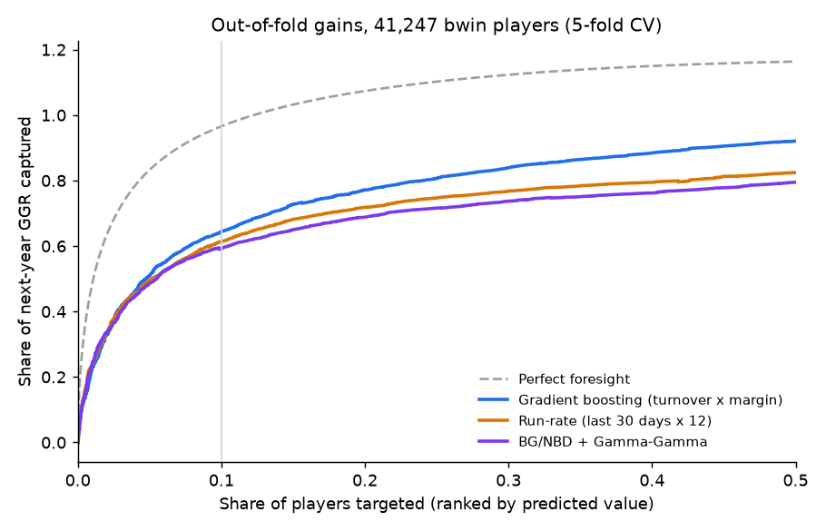

# Player Value Model: lifetime value and retention on real sports-betting data

Which new players will be worth the most over the next year, and which are about to stop betting?
This project answers both from a player's **first 90 days**, on **real daily betting records of 46,339
bwin customers** (bwin is now part of Entain). It compares the classic lifetime value model used in
CRM (BG/NBD + Gamma-Gamma) with a simple run-rate rule and a gradient-boosting model.

Features are built in **PySpark with Spark SQL window functions** over 2.8 million player-day rows.



## Results (5-fold cross-validation, 41,247 players, out-of-fold predictions)

The target is each player's next 365 days (days 90 to 454 after their first stake): turnover (total
stakes) and GGR (gross gaming revenue = stakes minus payouts).

| Model | Share of next-year GGR from the top 10% of players it picks | Turnover Gini (normalised) | Total GGR forecast vs actual |
|---|---|---|---|
| **Gradient boosting** (turnover × house margin) | **64.4%** | **0.830** | **0.99×** |
| Run-rate (last 30 days × 365/30) | 61.3% | 0.703 | 1.54× |
| BG/NBD + Gamma-Gamma | 59.2% | 0.668 | 0.53× |
| Gradient boosting trained on GGR directly | 63.4% | — | 1.00× |

Paired bootstrap over players (1,000 resamples):

- Gradient boosting vs run-rate: **+3.1 points** of next-year GGR captured in the top 10% (95% CI +1.1 to +4.9), and **+0.127** turnover Gini (95% CI +0.109 to +0.152).
- Gradient boosting vs BG/NBD + Gamma-Gamma: **+5.3 points** (95% CI +3.0 to +7.1), and +0.162 turnover Gini (95% CI +0.138 to +0.189).
- Predicting turnover and multiplying by the house margin vs predicting GGR directly: +1.0 point (95% CI −0.8 to +2.6), so no clear difference in cross-validation. In the out-of-time test below it held up much better (60.8% vs 53.7%).

**Retention** (does the player bet again in days 90 to 179? base rate 43.7%):

| Model | ROC AUC (5-fold CV) | ROC AUC (out-of-time) |
|---|---|---|
| Gradient boosting | **0.863** | 0.769 |
| Recency only (days since last bet) | 0.850 | **0.781** |
| BG/NBD probability alive | 0.685 | 0.571 |

The gradient-boosting retention model beats a recency rule in cross-validation but **not** on the
later cohort, so a recency rule is the honest default for a churn list until the model is retrained on
more recent data.

### Out-of-time check

Trained on the 39,038 players whose first stake was in February or March 2005 and tested on the 2,209
who started in April to June 2005. The ranking held up: gradient boosting's top 10% still captured
60.8% of next-year GGR (run-rate 54.6%, BG/NBD 53.0%), and its total GGR forecast was 1.19× actual.

### What the data says

- **Value is extremely concentrated.** With perfect foresight, the top 10% of players produce 96.6%
  of next-year GGR. The perfect-foresight line in the chart goes above 100% because some players beat
  the house, so their GGR is negative.
- **A player's luck does not persist, their stake level does.** The Spearman correlation between a
  player's payout ratio in the first 90 days and the next year is 0.20, while for stake level it is
  0.58. So the model predicts turnover, which is stable, and multiplies it by the house margin
  measured on the training players (12.9% on fixed odds, 6.6% live), weighted by each player's
  fixed-odds/live mix.
- **BG/NBD under-forecasts betting days by 40%.** It assumes each player bets at a steady rate until
  they drop out for good. Sports betting is seasonal: active players in the cohort fell to 9,197 in
  July 2005, rose back to 17,435 in September when the football season restarted, and jumped from
  12,098 in May 2006 to 16,945 in June 2006 for the World Cup. A player who goes quiet over the
  summer looks to BG/NBD as if they have dropped out. Its
  ranking is still reasonable, but its totals are not usable for forecasting without a seasonal
  adjustment.
- **The run-rate rule over-forecasts by 54%.** Early activity is the most intense a new player will
  ever be, so scaling it up to a year overstates value.
- **Decile calibration** (gradient boosting, cross-validated): the top decile is forecast within 6% of
  its actual GGR (1.05×), and every decile's GGR forecast falls between 0.73× and 1.05× of actual
  (`results/deciles_gbm_cv5.csv`).

## How it works

```
data/raw/ (3 CSVs)  ->  pvm/spark_features.py + pvm/sql/features.sql   (PySpark, Spark SQL)
                    ->  pvm/models.py   run-rate, BG/NBD + Gamma-Gamma (pvm/btyd.py), gradient boosting
                    ->  pvm/evaluate.py top-decile share, normalised Gini, Spearman, AUC, paired bootstrap
                    ->  results/metrics.json, results/deciles_gbm_cv5.csv, results/gains_ggr.png
```

- **Day 0** is the player's first day with a stake. Days that only carry winnings from an earlier
  bet (settlements, about 10% of fixed-odds rows) don't count as activity.
- **Features (days 0 to 89)** in Spark SQL: stake in week 1, month 1 and month 3; active days;
  recency; gaps between betting days (`LAG` over each player's active days); peak rolling 7-day stake
  (`SUM ... OVER (PARTITION BY player ORDER BY day RANGE BETWEEN 6 PRECEDING AND CURRENT ROW)`); the
  day by which half the stake was placed (running share window); live-betting share; payout ratio;
  stake per bet; time from registration to first deposit and first bet; age, gender and country.
- **BG/NBD and Gamma-Gamma** are written from the published likelihoods (Fader, Hardie and Lee, 2005)
  and fitted by maximum likelihood with SciPy; a test checks that the fit recovers known parameters
  from simulated data.
- **Gradient boosting** uses scikit-learn's histogram gradient boosting with a Poisson loss, which
  suits non-negative, heavy-tailed turnover.
- Only players whose full 455-day window fits inside the data (to 31 August 2006) are used.

## Run it

```bash
scripts/fetch_data.sh data/raw          # about 90 MB from the Transparency Project
pip install -e ".[dev]"                 # needs Java 17 for Spark
python run.py --data data/raw --out results
pytest -q && ruff check .
```

Or with Docker: `docker build -t player-value-model . && docker run -v "$PWD/results:/app/results" player-value-model`.

Tests (9) cover the Spark SQL features on a hand-made dataset (day 0, windows, gaps, targets,
settlement-only days), BG/NBD parameter recovery, Gamma-Gamma shrinkage and the metrics. GitHub
Actions runs ruff, the tests (with Java 17 for Spark) and a Docker build on every push.

## Limits

- The data is from 2005 and 2006, and one cohort (players who opened accounts in February 2005).
  Products, prices and player behaviour have changed since, so the numbers show the method, not
  today's values.
- Cross-validation folds share calendar time, so a shock like the 2006 World Cup affects training
  and test players alike. The out-of-time check reduces but doesn't remove this.
- There is no marketing, bonus or deposit-limit data, so the model can't separate value created by
  CRM actions from a player's own behaviour.
- The out-of-time test set is small (2,209 players), so its numbers are less precise than the
  cross-validated ones.

## Data and citation

Data from the Transparency Project of the Division on Addiction (Cambridge Health Alliance, a Harvard
Medical School teaching hospital), from its research collaboration with bwin Interactive
Entertainment AG (now Entain plc). The data is public and is downloaded by `scripts/fetch_data.sh`;
it is not included in this repository.

LaPlante, D. A., Schumann, A., LaBrie, R. A., & Shaffer, H. J. (2008). Population trends in Internet
sports gambling. *Computers in Human Behavior, 24*(5), 2399–2414. https://doi.org/10.1016/j.chb.2008.02.015

Fader, P. S., Hardie, B. G. S., & Lee, K. L. (2005). "Counting your customers" the easy way: An
alternative to the Pareto/NBD model. *Marketing Science, 24*(2), 275–284.
